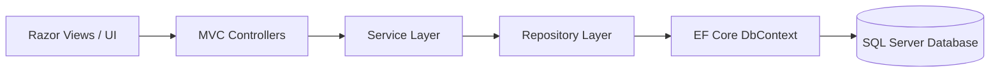

# Glovo-Like App — On-Demand Delivery Platform

<p align="center">
  
  
  
  
  
  
</p>

An on-demand food and grocery ordering platform inspired by **Glovo**, **Uber Eats**, and **DoorDash**. Developed with **ASP.NET Core MVC (.NET 9)**, **Entity Framework Core**, and **SQL Server**, this application follows clean **N-Tier Architecture** and the **Repository-Service Pattern** to manage products, customer accounts, real-time shopping sessions, and order dispatching.

---

## Features

- **Product & Menu Catalog**:
  - Browse food items, dishes, and categories.
  - Category-based filtering and instant search.
  - Detailed product view cards with pricing, descriptions, and stock status.
- **Dynamic Shopping Cart**:
  - Session-backed shopping cart (`ISession`).
  - Add, adjust quantities, or remove items with automatic total/subtotal recalculation.
- **Customer Account Management**:
  - Customer registration, login, and profile updates.
  - Session authentication and personalized greeting.
- **Order Processing & Checkout**:
  - Seamless checkout flow generating order headers (`Commande`) and line-item details (`CommandeDetail`).
  - Order tracking portal ("My Orders") with real-time status updates (Pending, In Preparation, Delivered).
- **Courier & Dispatch Support**:
  - Dedicated `Livreur` courier model linked to deliveries for order dispatch.
- **Admin Dashboard**:
  - Full CRUD operations for menu management (add, edit, delete products).
  - Order fulfillment management and status updates.
- **Automatic EF Core Migrations**:
  - Applies pending database migrations at application startup automatically.

---

## Architecture & Design Patterns

The project follows a clean **N-Tier Architecture**:



- **Presentation Layer**: ASP.NET Core MVC Controllers and Razor views with responsive Bootstrap layouts.
- **Business Logic Layer (`Services/`)**: Handles domain rules, cart business logic, and order creation.
- **Data Access Layer (`Repos/`)**: Encapsulates database queries and operations using the Repository Pattern.
- **Persistence Layer (`Data/`)**: `MyDbContextGlovo` using Entity Framework Core 9.
- **Domain Entities (`Entities/`)**: Strongly-typed domain models (`Client`, `Livreur`, `Produit`, `Commande`, `CommandeDetail`).

---

## Project Structure

```text
Aymane.netProjet/
├── Web/
│   ├── Controllers/             # MVC Controllers
│   │   ├── AdminController.cs   # Menu & order management
│   │   ├── CartController.cs    # Shopping cart actions
│   │   ├── ClientController.cs  # Customer auth & profiles
│   │   ├── CommandeController.cs# Checkout & order tracking
│   │   ├── HomeController.cs    # Showcase & landing page
│   │   └── ProduitController.cs # Product listing & details
│   ├── Data/
│   │   └── MyDbContextGlovo.cs  # Entity Framework Core DbContext
│   ├── Entities/                # Domain models
│   │   ├── Base.cs              # Base entity with primary key
│   │   ├── Personne.cs          # Base person (Name, Phone, Auth)
│   │   ├── Client.cs            # Customer entity
│   │   ├── Livreur.cs           # Delivery courier entity
│   │   ├── Produit.cs           # Menu item / product entity
│   │   ├── Commande.cs          # Order header entity
│   │   └── CommandeDetail.cs    # Order line items
│   ├── Migrations/              # EF Core database migrations
│   ├── Repos/                   # Data access repositories
│   ├── Services/                # Application business logic services
│   ├── Views/                   # Razor Views (Admin, Cart, Client, Home, Produit)
│   ├── wwwroot/                 # Static assets (CSS, JavaScript, Images)
│   ├── appsettings.json         # Database connection & configurations
│   ├── Program.cs               # Application entrypoint & DI container
│   └── Aymane.netProjet.csproj  # Project dependencies (.NET 9)
├── Aymane.netProjet.sln         # Visual Studio Solution
├── .gitignore                   # Git ignore rules for .NET
└── README.md                    # Project documentation
```

---

## Database Model Overview

| Entity | Description | Key Relationships |
| :--- | :--- | :--- |
| **`Client`** | Registered customer | Places multiple `Commande` records |
| **`Livreur`** | Courier / delivery driver | Assigned to `Commande` records for fulfillment |
| **`Produit`** | Menu items / products | Associated with `CommandeDetail` line items |
| **`Commande`** | Order transaction header | Has one `Client`, one `Livreur`, and many `CommandeDetail` entries |
| **`CommandeDetail`**| Line-item with quantity & unit price | Links a `Produit` to its `Commande` |

---

## Getting Started

### Prerequisites

- [.NET 9.0 SDK](https://dotnet.microsoft.com/download/dotnet/9.0) or later
- [SQL Server](https://www.microsoft.com/sql-server/) (Express, Developer Edition, or LocalDB)
- [Visual Studio 2022](https://visualstudio.microsoft.com/) (v17.12+) or [VS Code](https://code.visualstudio.com/) with C# Dev Kit

### Installation & Run

1. **Clone the repository**:
   ```bash
   git clone https://github.com/LibrarianPoms/Glovo-Like-App.git
   cd Glovo-Like-App
   ```

2. **Configure Database Connection**:
   Open [`Web/appsettings.json`](Web/appsettings.json) and configure your SQL Server connection string:
   ```json
   {
     "ConnectionStrings": {
       "myCnn": "Server=(localdb)\\mssqllocaldb;Database=FoodDudes;Trusted_Connection=True;MultipleActiveResultSets=true;TrustServerCertificate=True;"
     }
   }
   ```

3. **Restore Dependencies & Build**:
   ```bash
   dotnet restore
   dotnet build
   ```

4. **Database Migrations**:
   The application automatically runs `dbContext.Database.Migrate()` on startup. You can also apply them manually:
   ```bash
   dotnet ef database update --project Web
   ```

5. **Start the Application**:
   ```bash
   cd Web
   dotnet run
   ```

6. Open your browser and navigate to:
   - Application: `https://localhost:5001` or `http://localhost:5000`

---

## Contributing

Contributions and feature requests are welcome!

1. Fork the Project
2. Create your Feature Branch (`git checkout -b feature/NewFeature`)
3. Commit your Changes (`git commit -m 'Add NewFeature'`)
4. Push to the Branch (`git push origin feature/NewFeature`)
5. Open a Pull Request

---

## License

This project is licensed under the [MIT License](LICENSE).
